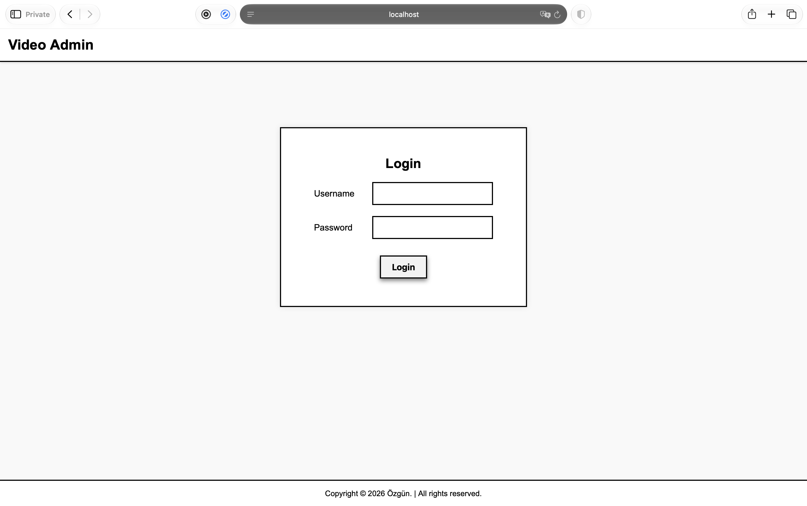
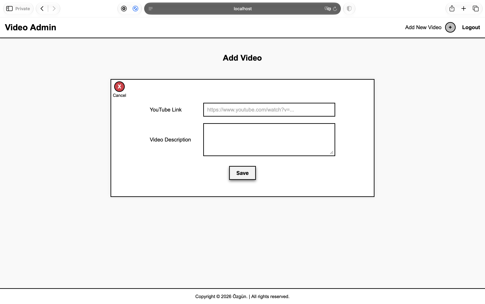
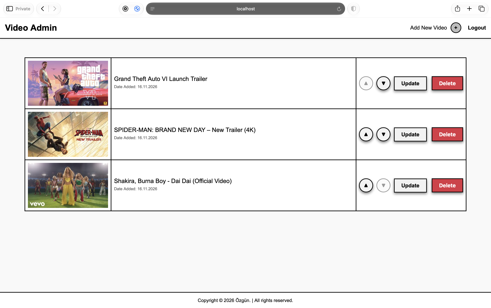

# Video Portal Management System

A simple video management panel built with PHP and MySQL. Administrators can add, update, reorder and soft-delete YouTube videos.

## Features
- **Authentication:** Admin login with hashed passwords, and logout
- **Video management:** Add, update, reorder and delete videos. Use the arrow buttons to move videos up or down in the list. Deleted videos are hidden, not removed from the database.
- **Security:** Prepared statements (SQL injection protection), output escaping (XSS), CSRF tokens, session fixation protection

## Screenshots

**Login**


**Add video**


**Video list**


## Technologies Used
- **PHP** 
- **MySQL** 

## Requirements
- PHP 8.2 or newer (with the mysqli extension)
- MySQL 8.4 or newer, or MariaDB 10.11 or newer

## Installation
1. Create the database:
   ```bash
   mysql -u root -p < schema.sql
   ```
2. If needed, edit the connection settings in `config.php` or set the environment variables `DB_HOST`, `DB_USER`, `DB_PASS` and `DB_NAME`.
3. Create an admin account (the password is hashed automatically):
   ```bash
   php create_admin.php admin YourStrongPassword
   ```
4. Start the server and open `http://localhost:8000`:
   ```bash
   php -S localhost:8000
   ```

## Files
- **index.php**: Redirects to the video list
- **login.php**: Login page
- **videos.php**: Video list, reordering and deletion
- **add_video.php**: Add a new video
- **edit_video.php**: Update a video
- **logout.php**: Logout
- **config.php**: Database connection, session, CSRF and helper functions
- **header.php**: Shared header bar
- **footer.php**: Shared footer
- **style.css**: Shared styles
- **create_admin.php**: Create an admin from the command line
- **schema.sql**: Database schema
